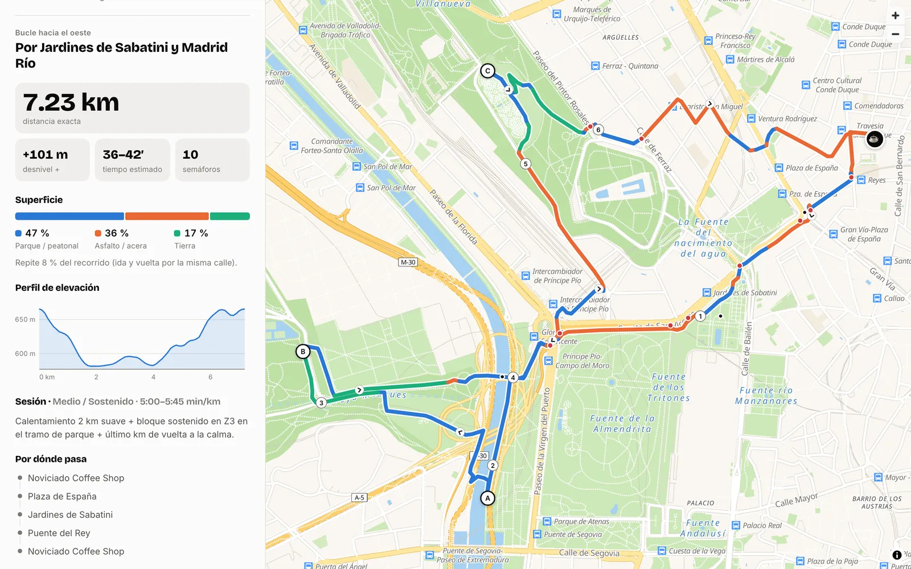
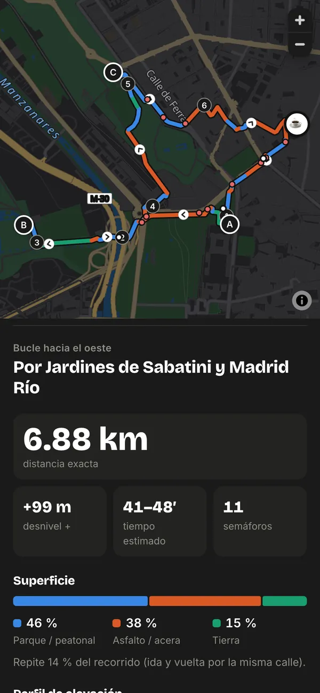
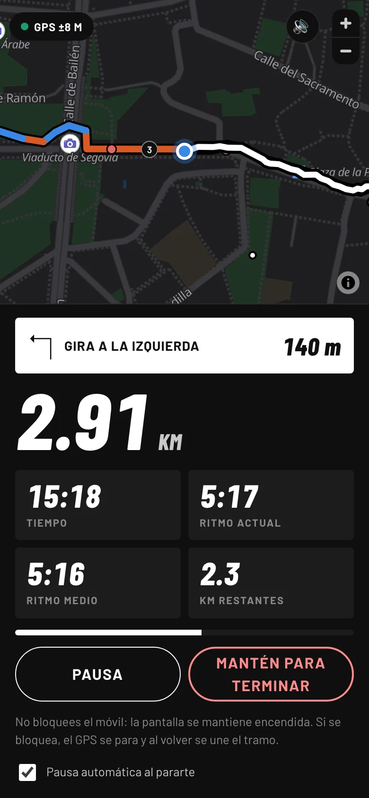

# Rutas Noviciado

Generador de rutas para salir a correr por Madrid. Todas empiezan y terminan en la cafetería
Noviciado Coffee Shop (Calle del Noviciado, 9) y ninguna pasa de 10 km.

Le dices cuántos kilómetros quieres, con qué intensidad y si prefieres parques o calles, y te propone
un bucle distinto cada vez: por Madrid Río, el Parque del Oeste, la Casa de Campo, el Retiro... o por
las plazas del centro. Luego puedes correrlo con la propia app, que te sigue con el GPS.

**Pruébala aquí: https://danielcs94.github.io/rutas-noviciado/**

Fue la primera versión. Luego la generalicé en [Rutas A→B](https://github.com/danielcs94/rutas-ab),
que hace rutas entre dos puntos cualesquiera de hasta 42 km.

<p>
  
  
</p>
<p>
  
</p>

## Qué te da cada ruta

- La distancia exacta y el tiempo estimado según el ritmo de la intensidad elegida.
- El desnivel positivo y un perfil de elevación. Al pasar el dedo por el perfil, se marca el punto en el mapa.
- Cuánta parte del recorrido es parque o paseo peatonal, cuánta asfalto y cuánta tierra.
- Los semáforos que te vas a encontrar.
- Si el bucle repite algún tramo (ir y volver por la misma calle).
- Los sitios conocidos por los que pasa, que también le dan nombre a la ruta.
- Un enlace para abrirla en Google Maps y la opción de descargarla en GPX para Strava, Garmin o Komoot.

Con "Por dónde" eliges el tipo de bucle: Parques (los puntos de paso se acercan a zonas verdes),
Ciudad (no busca parques y elige el bucle con más calle) o Mezcla (la mitad de cada).

Se puede añadir a la pantalla de inicio del móvil y se abre como una app normal.

## Modo carrera

Con "Empezar carrera" la app usa el GPS del móvil mientras corres la ruta: distancia, tiempo, ritmo
actual y medio, kilómetros que faltan y el próximo giro. Te avisa por voz de los giros, de cada
kilómetro con su ritmo y de si te sales de la ruta (y hacia dónde queda). Se pausa sola en los
semáforos, y al terminar te da los parciales y el GPX de lo que has corrido de verdad. Las carreras se
guardan en "Mis carreras". Al empezar en el móvil, una ventana explica cómo bloquear los toques (con el
Acceso guiado en iPhone) para llevarlo encendido en el bolsillo sin pulsar nada.

Es el mismo modo carrera que [Rutas A→B](https://github.com/danielcs94/rutas-ab#modo-carrera), donde
explico cómo mide la distancia.

## Cómo funciona

Todo pasa en el navegador. No hay backend ni APIs de pago.

Para inventar un bucle, la app elige una dirección al azar y dibuja un círculo que pasa por la
cafetería. Sobre ese círculo coloca tres puntos de paso y los desplaza hacia la zona cercana con más
sendas de parque o de tierra. Luego pide la ruta a pie que une esos puntos a
[Valhalla](https://github.com/valhalla/valhalla), un router de código abierto que usa datos de
OpenStreetMap.

La distancia que sale casi nunca es la que pediste a la primera, así que el tamaño del círculo se
ajusta con el método de la secante: dos o tres intentos y la ruta queda justo por debajo de los
kilómetros que querías. Cada vez se generan cuatro bucles, uno hacia cada lado de Madrid, y se queda
el que mejor encaja con la intensidad (desnivel, semáforos y cantidad de asfalto). Los otros tres
salen como alternativas.

La superficie y los semáforos los saco de OpenStreetMap, y el desnivel de un modelo de terreno de
Copernicus. Esos datos están precalculados en `data/` para no depender de servicios lentos cada vez
que se genera una ruta.

El mapa es vectorial, con MapLibre GL y teselas gratuitas de OpenFreeMap. Le cambié los colores para
que se parezca a Apple Maps. La interfaz tiene un estilo deportivo (titulares condensados en cursiva,
blanco y negro y acento neón) en modo claro y oscuro, igual que Rutas A→B.

```
js/
  config.js      punto de salida, lugares de referencia e intensidades
  planner.js     genera los bucles, ajusta la distancia y los puntúa
  api.js         peticiones a Valhalla (y a OSRM si Valhalla falla)
  datasets.js    lee los datos precalculados de superficie, semáforos y elevación
  map.js         el mapa y todo lo que se dibuja encima
  mapstyle.js    la paleta tipo Apple Maps
  profile.js     el perfil de elevación en SVG
  app.js         la interfaz
  run.js         el modo carrera: pantalla, GPS, voz y mis carreras
  tracker.js     las cuentas de la carrera: distancia, ritmos, parciales, giros y desvíos
tools/
  build_surface.py     descarga las calles de OpenStreetMap y las clasifica
  build_elevation.py   descarga la rejilla de elevación
  serve.py             servidor local sin caché
  release.py           versiona los archivos antes de publicar
```

## Cosas que me dieron guerra

Al principio la superficie se consultaba en directo a Overpass (la API de OpenStreetMap). Cada consulta
tardaba unos 20 segundos y muchas veces devolvía error. Al final escribí un script en Python que
descarga una vez las 38.785 calles y sendas de la zona, las clasifica en asfalto, parque o tierra y lo
guarda todo en un JSON de menos de 2 MB. Desde la app se consulta al instante.

El servidor público de Valhalla solo acepta 10 puntos por petición. Las rutas con más puntos se parten
en trozos que comparten el punto de unión y luego se pegan.

Para que el router no se fuera por calles cuando había un parque al lado, los puntos de paso se
"imantan" a la zona con más metros de senda verde dentro de un radio. Es lo que más se nota en el
resultado.

Cuando la publiqué en GitHub Pages, en el móvil a veces no cargaba el mapa. El navegador guardaba en
caché unos archivos nuevos y otros viejos, y la mezcla rompía la app. Ahora `tools/release.py` añade
una versión a todos los módulos antes de cada publicación.

## Ejecutarla en local

```bash
python3 tools/serve.py
```

Y abrir http://localhost:5180. No hace falta instalar nada más.

Antes de subir cambios:

```bash
python3 tools/release.py
```

Si quieres regenerar los datos de OpenStreetMap o ampliar la zona (cambiando `BBOX` en los scripts),
necesitas `pip install requests` y:

```bash
python3 tools/build_surface.py
python3 tools/build_elevation.py
```

## Limitaciones

El enlace de Google Maps lleva los tres puntos de paso, pero Google recalcula el camino entre ellos y
puede no coincidir del todo. Si quieres seguir la ruta exacta, usa el GPX.

Generar una ruta tarda unos 20 segundos, porque los servidores gratuitos limitan cuántas peticiones
les puedes hacer seguidas.

Las rutas que salen hacia el norte o el este tienen menos parques cerca y suelen llevar más asfalto.

El modo carrera necesita la pantalla encendida: una web no puede usar el GPS con el móvil bloqueado.
Con el Acceso guiado del iPhone se puede llevar encendida sin que se pulse nada.
Tampoco tiene acceso a Salud de Apple ni a Health Connect; para guardar ahí la carrera hay que pasar el
GPX por una app como Strava.

## Créditos

Datos de calles © colaboradores de OpenStreetMap (ODbL). Rutas con Valhalla y OSRM de FOSSGIS. Mapa
de OpenFreeMap. Elevación del modelo Copernicus GLO-90 servido por Open-Meteo.
